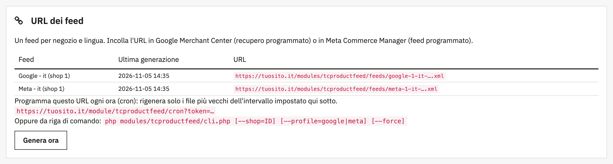
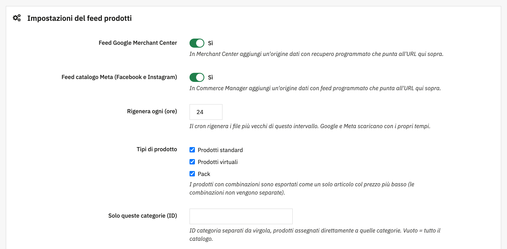

# Threecommerce Product Feed: Google Merchant Center and Meta catalog feeds for PrestaShop

A PrestaShop module that generates the **product feeds for Google Merchant Center and the Meta catalog** (Facebook and Instagram), kept up to date by a cron job. One XML file per profile, shop and language, at a secret URL you paste into Merchant Center or Commerce Manager.

**Compatibility:** PrestaShop 8.0+ / 9.x declared (tested on 9.2.0) · PHP 8.1 – 8.4
**License:** commercial · coming soon

## Features

- **Google Merchant Center and Meta** feeds (RSS 2.0 with the `g:` namespace), switched on independently.
- **One feed per shop and language**, with a non-guessable URL (token derived from the shop's cookie key), ready for a scheduled fetch.
- **Prices as in your shop**: tax included, for the visitors' group, with specific prices, date ranges and catalog price rules already applied. `price` plus `sale_price` when a product is discounted.
- **Complete data**: title, description (HTML stripped), link, main and additional images, availability, condition, brand (manufacturer), GTIN (EAN-13, ISBN or UPC), MPN, Google product category, product type from the category path, and `identifier_exists = no` for Google when GTIN and MPN are missing.
- **Filters**: product types (standard, virtual, packs), categories, exclusion by product field or feature (handy for "coming soon" products), out-of-stock products.
- **Safe to fetch**: the file is built as a temporary file and renamed at the end, so nobody downloads a half-written feed.
- **Hourly cron** through a secured URL or a command line script, plus a *Generate now* button.
- Italian translation included.

## Requirements

- PrestaShop 8.0 or newer, or 9.x
- PHP 8.1 or newer
- A cron job calling the module's URL (or `cli.php`) every hour
- Your own Google Merchant Center and/or Meta Commerce Manager accounts (verified domain, shipping, returns and taxes are set there)

## Tested with

PrestaShop 9.2.0 (Hummingbird theme): installation, generation from the command line and from the cron URL, price and sale price, combinations, filters by type, category and field, out-of-stock handling, and the feed files over HTTP. PrestaShop 8 has **not** been tested yet.

## Limits

- Products with combinations are exported as a single item at the lowest price: variants (color, size) are not split.
- No direct API upload: Google and Meta download the file.
- Pre-orders are not handled: use the field exclusion to keep them out.
- Prices are for the visitors' group, quantity 1, in the shop's default country and currency.

## Availability

This module is **not yet available for purchase**. See the [product page](https://www.threecommerce.it/feed-prodotti-google-merchant-meta-prestashop?utm_source=github&utm_medium=readme&utm_campaign=prestashop-product-feed) for its status, or [get in touch](https://www.threecommerce.it/contatti?utm_source=github&utm_medium=readme&utm_campaign=prestashop-product-feed) to be notified at launch or to ask for information.

## Documentation and support

- [Changelog](CHANGELOG.md) (in Italian)
- Support and custom development: [threecommerce.it/contatti](https://www.threecommerce.it/contatti?utm_source=github&utm_medium=readme&utm_campaign=prestashop-product-feed)

---

*This repository is the public showcase of the module. The source code is kept in a private repository.*
